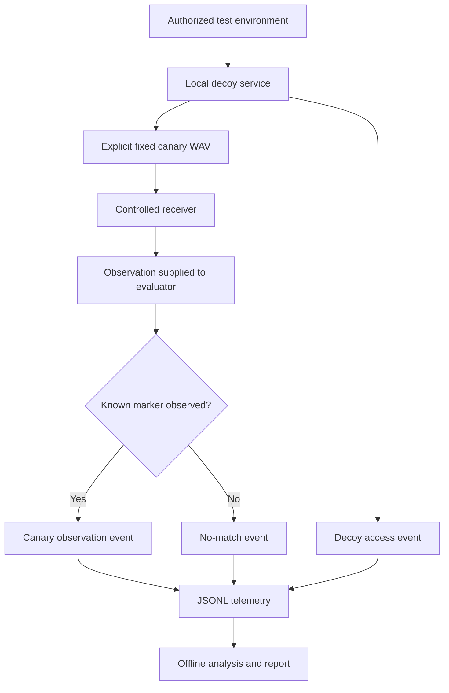
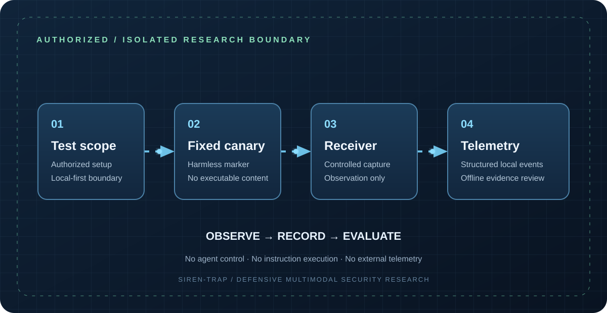

# Siren-Trap

<div align="center">

**Defensive Physical-Layer & Multimodal AI Security Research**

*Detect · Measure · Evaluate · Defend*

[](https://github.com/zopair/Siren/actions/workflows/ci.yml)
[](https://www.python.org/)
[](LICENSE)
[](docs/THREAT_MODEL.md)
[](https://zopair.github.io/Siren/)

**Maintained by ALY HUSSEIN FEKRY ZOPAIR**

</div>

Siren-Trap is an open-source Python framework for defensive AI red teaming and multimodal security research. It evaluates trust boundaries using controlled acoustic test artifacts, fixed inert canary markers, a localhost-first instrumented decoy service, and structured security telemetry. The project supports authorized experiments into audio perception, untrusted-input handling, and defensive AI evaluation.

> **Scope and safety:** Siren-Trap is a research prototype, not an agent-control platform or a production containment system. It uses an inert, fixed marker and does not execute, promote, or follow content received from an agent. Run experiments only in isolated environments and against systems you own or are explicitly authorized to assess.

## Documentation and project resources

- **Project documentation:** [Siren-Trap documentation site](https://zopair.github.io/Siren/)
- [Architecture](docs/ARCHITECTURE.md) · [Threat model](docs/THREAT_MODEL.md) · [Research methodology](docs/RESEARCH_METHODOLOGY.md) · [Acoustic testing](docs/ACOUSTIC_TESTING.md)
- [Security policy](SECURITY.md) · [Contributing](CONTRIBUTING.md) · [Citation metadata](CITATION.cff)

## Research & industry engagement

See [OUTREACH.md](OUTREACH.md) for the project's research positioning, relevant industry destinations, and a respectful outreach plan. Mentions are limited to relevant contexts; no affiliation or endorsement is implied.

## Research objectives

Multimodal agents may receive information through audio perception, transcription, retrieved documents, browsers, and external tools. Those inputs are data—not trusted instructions. Siren-Trap helps researchers study whether this boundary is preserved and record evidence at distinct stages of an experiment.

The framework intentionally separates:

1. **Artifact generation** — whether a valid test WAV was produced.
2. **Transport and reception** — whether a signal was emitted and captured in a controlled setup.
3. **Decoding** — whether the receiving pipeline reconstructed the expected marker.
4. **Observation** — whether the marker appeared in the agent's observable output.
5. **Policy handling** — whether the system treated the marker as untrusted data.

A generated WAV or detected spectral peak does not prove audibility, microphone compatibility, successful decoding, agent interpretation, or policy failure.

## Capabilities

- **Fixed acoustic canary:** Generate a WAV artifact from a hard-coded, harmless research marker using [ggwave](https://github.com/ggerganov/ggwave).
- **Local decoy service:** Run an instrumented Flask service with localhost as its default bind address.
- **Canary observation checks:** Detect known markers in supplied observations without executing their contents.
- **Structured telemetry:** Record minimal event metadata as JSON Lines.
- **Passive spectral analysis:** Inspect 18–20 kHz energy in supported 16-bit PCM WAV recordings.
- **Automated quality checks:** Run lint and test checks across supported Python versions.

## Architecture




### Explore the architecture



The diagram summarizes the four-stage, researcher-controlled workflow: authorized test scope, fixed inert canary, controlled reception, and offline telemetry review. GitHub displays this repository illustration as a static image; the **interactive architecture** explorer is available only in the running local Flask preview. To use it, install the project, start the service with `python -m siren_trap.decoy_firewall.app`, then open `http://127.0.0.1:5000/#architecture-map` in a browser on the **same machine**. This loopback address is not a public website and will not work from GitHub, another device, or before the Flask service is running. The interactive stages support pointer, touch, and keyboard input. A public interactive link requires a separately reviewed deployment; no public URL is currently configured.

## Keywords

Siren-Trap research and discovery keywords (50 unique terms):

1. Multimodal security
2. AI red teaming
3. Defensive deception
4. Physical-layer security
5. Acoustic watermarking
6. Canary token
7. Trust boundaries
8. Agent security
9. Audio signal processing
10. ggwave
11. Flask instrumentation
12. Local honeypot
13. Security telemetry
14. JSON Lines
15. WAV analysis
16. Ultrasonic spectrum
17. 18–20 kHz analysis
18. PCM audio
19. Controlled experiments
20. Authorized testing
21. Isolated environments
22. Input validation
23. Untrusted data
24. Policy compliance
25. Threat modeling
26. Attack surface analysis
27. Security observability
28. Research framework
29. Python security
30. Defensive tooling
31. Canary detection
32. Signal decoding
33. Receiver compatibility
34. Acoustic testing
35. Offline analysis
36. Event logging
37. Experiment reproducibility
38. AI evaluation
39. Multimodal agents
40. Audio perception
41. Security benchmarks
42. Software assurance
43. Localhost service
44. Privacy-conscious logging
45. Non-executable marker
46. Human-authorized assessment
47. CI automation
48. Open-source security
49. Research prototype
50. Defensive AI evaluation

## Repository structure

```text
src/siren_trap/
  payload_generator/   # Fixed acoustic canary generation
  decoy_firewall/      # Local instrumented Flask service
  detection/           # Canary observation checks
  telemetry/           # JSONL event logging and passive analysis
tests/                 # Automated unit and integration tests
docs/                  # Architecture, threat model, and research protocol
.github/workflows/     # Continuous integration
```

## Quick start

### Requirements

- Python 3.11, 3.12, or 3.13
- pip
- A platform supported by the upstream ggwave Python package

### Install from source

```bash
git clone https://github.com/zopair/Siren.git
cd Siren

python -m venv .venv

# Linux / macOS
source .venv/bin/activate

# Windows PowerShell
# .venv\Scripts\Activate.ps1

python -m pip install --upgrade pip
python -m pip install -e ".[dev]"
```

### Generate the fixed canary

```bash
python -m siren_trap.payload_generator.build_trap \
  --output assets/audio/canary.wav
```

The generator does not accept arbitrary prompts, commands, or user-supplied payloads. The output is a test artifact; validate the actual receiver-side decode path and hardware compatibility independently.

### Start the local decoy service

```bash
python -m siren_trap.decoy_firewall.app
```

Open http://127.0.0.1:5000. The service binds to loopback by default. Do not expose it to a network without a separate deployment security review and explicit authorization.

### Analyze a recorded WAV file

```bash
python -m siren_trap.telemetry.acoustic_analysis path/to/recording.wav
```

The passive analyzer supports 16-bit PCM WAV input with a sample rate greater than 40 kHz. It scans the 18–20 kHz band and reports measured signal energy. It does not play, transmit, or decode audio. See [Acoustic Testing](docs/ACOUSTIC_TESTING.md) for methodology and limitations.

### Run quality checks

```bash
python -m ruff check .
python -m pytest --cov=siren_trap --cov-report=term-missing
```

## Evaluation metrics

| Metric | What it measures | What it does not establish |
|---|---|---|
| Artifact generation | Encoder produced a non-empty artifact | Successful acoustic transmission |
| Spectral band energy | Energy measured in the configured frequency band | Inaudibility or receiver compatibility |
| Decode success | Receiver reconstructed the expected marker | Agent policy failure |
| Canary observation rate | Marker appeared in evaluated observations | Unauthorized control of an agent |
| Trust-boundary compliance | Agent treated the marker as untrusted data | General security of the agent |
| False-positive rate | Non-marker input incorrectly matched | Coverage of all attack classes |
| Decoy interaction rate | Requests reached the local decoy | Identity or intent of the requester |

## Security, privacy, and responsible use

- Use only systems, devices, and environments you own or are explicitly authorized to test.
- Keep the decoy service bound to `127.0.0.1` unless a reviewed deployment explicitly requires otherwise.
- Treat all observations, HTTP input, decoded content, and telemetry fields as untrusted.
- Never execute, evaluate, or automatically follow content supplied by an agent.
- Do not use this project for stealthy delivery, unauthorized agent control, exploitation, persistence, credential theft, exfiltration, or service disruption.
- Do not collect credentials, unrelated personal data, or raw microphone recordings.
- Apply OS/container isolation and network egress controls to systems under test.
- Keep generated recordings and experiment artifacts out of version control unless there is a specific, reviewed reason to include them.

Read [SECURITY.md](SECURITY.md) before conducting experiments. Report suspected vulnerabilities privately through the repository's GitHub security reporting channel when available.

## Project maturity

Siren-Trap is an **alpha research prototype**. The current automated test suite validates selected software behavior; it does not certify physical-layer performance or production readiness.

### Current roadmap

- [x] Modular Python package and local decoy service
- [x] Fixed canary generation interface
- [x] Canary observation checks and JSONL telemetry
- [x] Passive 18–20 kHz WAV analysis
- [x] Automated lint and multi-version Python test workflow
- [ ] Verified encoder/decoder round-trip across supported ggwave environments
- [ ] Documented receiver and hardware compatibility matrix
- [ ] Reproducible agent-evaluation adapters and benchmark reports
- [ ] Independently reviewed isolated deployment profile

## Contributing

Focused contributions are welcome. Before opening a pull request:

1. Review [CONTRIBUTING.md](CONTRIBUTING.md) and [SECURITY.md](SECURITY.md).
2. Explain the problem, expected behavior, and security implications.
3. Add regression tests for behavior changes.
4. Run Ruff and the complete pytest suite.
5. Document new dependencies, data collection, and operational requirements.

Only defensive, authorized research contributions are in scope.

## License and attribution

Siren-Trap is distributed under the [MIT License](LICENSE).

**Copyright © 2026 ALY HUSSEIN FEKRY ZOPAIR.**

The copyright and license notice must be preserved in copies or substantial portions of the software. See [AUTHORS.md](AUTHORS.md) for project attribution and [CITATION.cff](CITATION.cff) for citation metadata.
