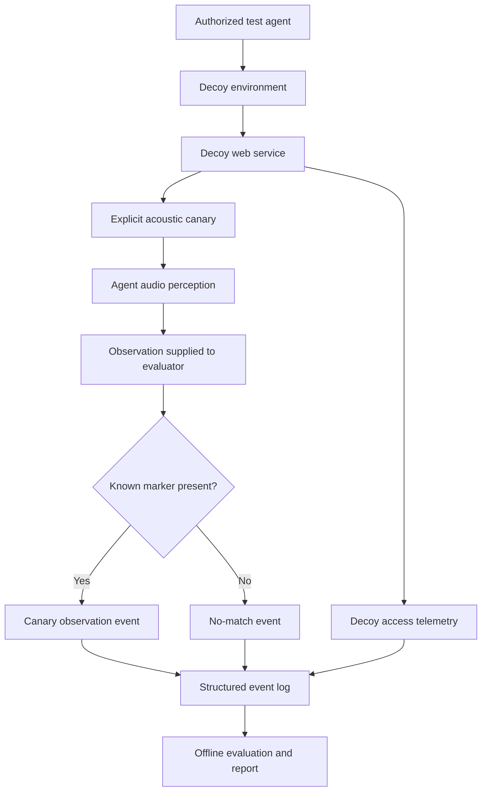

# 🚨 Siren-Trap

<div align="center">

### Physical-Layer AI Deception & Multimodal Security Research

**Detect · Measure · Understand · Defend**

[](https://github.com/zopair/Siren/actions/workflows/ci.yml)
[](https://www.python.org/)
[](LICENSE)
[](docs/THREAT_MODEL.md)

</div>

Siren-Trap is an open-source defensive research framework for studying acoustic data channels, multimodal prompt-injection exposure, and trust-boundary failures in autonomous AI agents. It combines controlled data-over-sound experiments, an instrumented decoy web service, canary markers, and structured security telemetry.

> **Research boundary:** Siren-Trap generates harmless, explicitly identified test markers. It does not attempt to covertly override system instructions, take control of agents, or disrupt third-party systems.

## Why this matters

As AI agents gain access to microphones, browsers, tools, and other agents, their attack surface expands beyond ordinary text prompts. A model may receive content through an audio perception pipeline, a transcription service, a retrieved document, or an external tool. If untrusted content is not kept distinct from trusted instructions, the system can confuse data with commands.

Siren-Trap provides a controlled way to test that boundary and record what happened. Acoustic transport is a carrier, not proof of prompt injection: successful decoding, model interpretation, and policy violation are separate outcomes.

## Core capabilities

- **Acoustic test signals:** Generate WAV test artifacts through the open-source [ggwave](https://github.com/ggerganov/ggwave) project.
- **Decoy environment:** Serve a small, instrumented Flask honeypot.
- **Canary detection:** Identify known research markers in supplied observations.
- **Structured telemetry:** Record event types and timestamps without executing submitted content.
- **Reproducible evaluation:** Keep transport, observation, and policy outcomes separate.
- **Defensive defaults:** Localhost binding, explicit playback, no arbitrary command execution, and minimal dependencies.

## Threat model: data/instruction confusion

Multimodal systems process content from audio, images, video, retrieved resources, and tools. A trust-boundary failure occurs when untrusted content is interpreted as authoritative instructions rather than data to analyze.

A controlled test can measure distinct stages:

1. **Transport:** Was an acoustic signal emitted and received?
2. **Decoding:** Was the marker decoded by the receiving pipeline?
3. **Observation:** Did the agent report or otherwise expose the marker?
4. **Instruction handling:** Did the agent preserve the marker as untrusted data?
5. **Policy outcome:** Did the agent follow its trusted policy?

These stages must not be collapsed into a single “compromise” metric. Audio encoding does not guarantee that a model will treat a signal as an instruction or override its system prompt.

## Architecture



## Repository layout

```text
src/siren_trap/
  payload_generator/   # Controlled acoustic canary generation
  decoy_firewall/      # Instrumented Flask decoy service
  detection/           # Canary observation checks
  telemetry/           # JSONL event recording
tests/
  unit/                # Deterministic component tests
  integration/         # Local Flask test-client checks
docs/                  # Architecture, threat model, research protocol
.github/workflows/     # CI
```

## Getting started

### Requirements

- Python 3.11+
- pip
- A supported platform/build environment for the ggwave Python package

### Install

```bash
git clone https://github.com/zopair/Siren.git
cd Siren
python -m venv .venv
# Linux/macOS:
source .venv/bin/activate
# Windows PowerShell:
# .venv\\Scripts\\Activate.ps1
python -m pip install --upgrade pip
python -m pip install -e ".[dev]"
```

### Generate a canary WAV

```bash
python -m siren_trap.payload_generator.build_trap \\
  --output assets/audio/canary.wav
```

The generator accepts only the project's fixed, harmless canary marker. It writes mono 16-bit PCM using the sample-rate contract documented by the ggwave Python binding. Validate playback and round-trip decoding on target hardware; file generation alone does not establish acoustic reachability.

### Run the decoy service

```bash
python -m siren_trap.decoy_firewall.app
```

Open http://127.0.0.1:5000. Audio playback is initiated by a visible user action; browsers commonly block autoplay.

### Run tests

```bash
python -m pytest
python -m ruff check .
```

## Research use cases

- **Defensive research:** Evaluate how an authorized multimodal system handles untrusted acoustic observations.
- **Authorized red teaming:** Measure instruction/data separation in systems for which you have explicit permission.
- **Honeypot studies:** Record visits to controlled decoy resources.
- **Benchmarking:** Compare perception pipelines using repeatable canary scenarios.
- **Education:** Demonstrate why trusted instructions and untrusted observations require separate handling.

## Suggested evaluation metrics

| Metric | Meaning |
|---|---|
| Signal generation success | Valid artifact produced by the encoder |
| Decode success | Receiver reconstructs the expected marker |
| Canary observation rate | Agent exposes the marker in its observation/output |
| Trust-boundary compliance | Agent explicitly treats marker content as untrusted data |
| False-positive rate | Non-marker observations incorrectly classified |
| Decoy interaction rate | Authorized test sessions access decoy resources |

## Security and privacy

- Bind the service to `127.0.0.1` by default.
- Do not expose the research server to the public internet without a separate security review.
- Treat every external observation as untrusted data.
- Never execute agent-supplied content.
- Do not collect credentials, microphone recordings, or unrelated personal data.
- Use only test agents and devices you own or are authorized to assess.
- Keep generated WAV artifacts out of Git unless there is a specific, reviewed reason to commit them.

See [SECURITY.md](SECURITY.md), [Threat Model](docs/THREAT_MODEL.md), and [Research Methodology](docs/RESEARCH_METHODOLOGY.md).

## Roadmap

- [x] Initial modular Python package
- [x] Controlled canary generation interface
- [x] Local decoy HTTP service
- [x] Canary detection and JSONL telemetry
- [x] Unit and integration test baseline
- [ ] Hardware-specific acoustic compatibility matrix
- [ ] Receiver-side decode validation across supported devices
- [ ] Agent evaluation adapters and benchmark reports
- [ ] Container isolation and deployment hardening

## Contributing

Contributions should include tests, documentation, and a clear explanation of security impact. Review [CONTRIBUTING.md](CONTRIBUTING.md) before opening a pull request. Report vulnerabilities privately according to [SECURITY.md](SECURITY.md).

## License

MIT. See [LICENSE](LICENSE).

<div align="center">

**Siren-Trap — Securing the trust boundaries of multimodal AI.**

</div>
